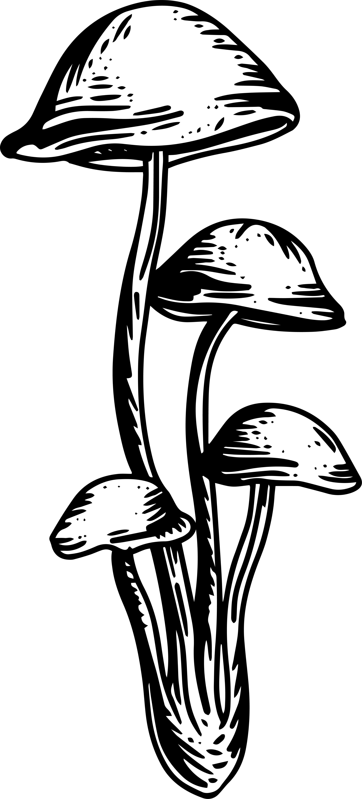
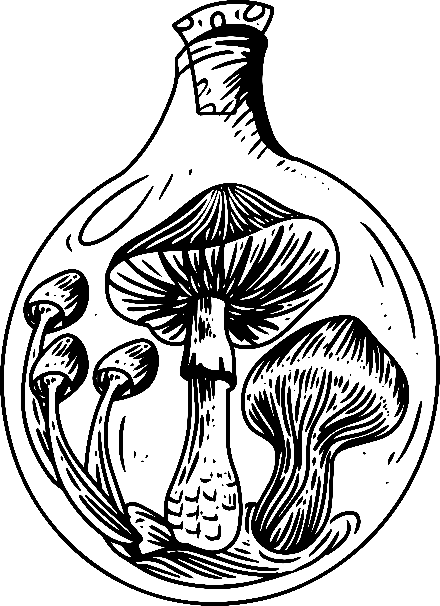
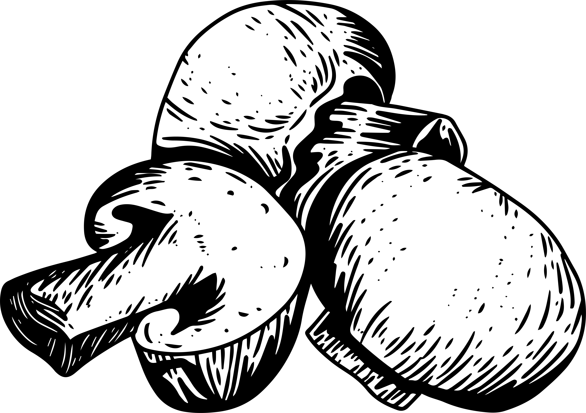
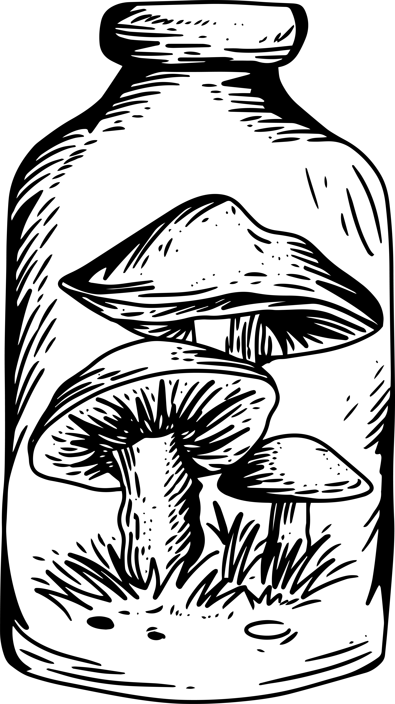
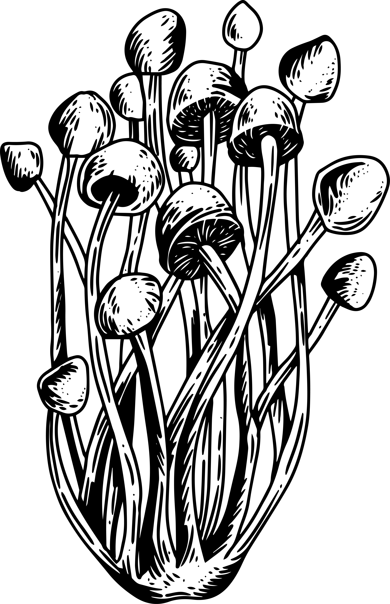

# Mushroom Illustration Implementation Guide
## Earthy Organics Website Enhancement

### Available Mushroom Illustrations
You have 10 unique hand-drawn vintage mushroom illustrations in multiple formats:
- **Location**: `assets/img/mushroom-hand-drawn-vintage-illustration/`
- **Formats**: PNG, SVG, EPS, AI
- **Files**: 1.png through 10.png

### Strategic Placement Recommendations

#### 1. Homepage (Already Implemented)
- **Hero Section**: Subtle background decorations (1.png, 4.png)
- **About Section**: Single accent mushroom (3.png)
- **Features Section**: Side decorations (6.png, 8.png)
- **Product Section**: Inverted mushrooms for contrast (5.png, 7.png)
- **Blog Section**: Corner decorations (2.png, 9.png)
- **Footer**: Subtle footer accents (10.png, 3.png)

#### 2. Product Pages
```html
<!-- Product Detail Page Enhancements -->
<div class="product-decoration" style="position: absolute; top: 20px; right: 20px; opacity: 0.3;">
    
</div>

<!-- Product Grid Decorations -->
<div class="category-mushroom" style="position: absolute; left: 0; top: 50%; transform: translateY(-50%); opacity: 0.2;">
    
</div>
```

#### 3. About/History Pages
```html
<!-- Story Section Enhancement -->
<div class="story-decoration">
    
</div>

<!-- Timeline Decorations -->
<div class="timeline-mushroom">
    
</div>
```

#### 4. Blog/Article Pages
```html
<!-- Article Header Decoration -->
<div class="article-decoration" style="position: relative;">
    
</div>

<!-- Sidebar Widget Enhancement -->
<div class="widget-mushroom">
    
</div>
```

#### 5. Contact Page
```html
<!-- Contact Form Enhancement -->
<div class="contact-decoration">
    
</div>
```

### CSS Classes for Easy Implementation

#### Basic Decoration Classes
```css
.mushroom-decoration {
    position: absolute;
    opacity: 0.3;
    z-index: 1;
    pointer-events: none;
    transition: all 0.3s ease;
}

.mushroom-decoration.large { max-width: 150px; }
.mushroom-decoration.medium { max-width: 100px; }
.mushroom-decoration.small { max-width: 60px; }

.mushroom-decoration.left { left: 20px; }
.mushroom-decoration.right { right: 20px; }
.mushroom-decoration.center { left: 50%; transform: translateX(-50%); }
```

#### Themed Variations
```css
.mushroom-decoration.vintage { filter: sepia(40%) saturate(80%); }
.mushroom-decoration.natural { filter: hue-rotate(30deg) saturate(1.1); }
.mushroom-decoration.monochrome { filter: grayscale(100%) brightness(0.8); }
.mushroom-decoration.inverted { filter: brightness(0) invert(1); }
```

### Implementation Examples by Page Type

#### Product Category Pages
```html
<!-- Add to category headers -->
<div class="category-header" style="position: relative;">
    <h2>Lion's Mane Products</h2>
    
</div>
```

#### Testimonial Sections
```html
<!-- Enhance testimonial cards -->
<div class="testimonial-card" style="position: relative;">
    
    <!-- testimonial content -->
</div>
```

#### Newsletter Sections
```html
<!-- Newsletter signup enhancement -->
<div class="newsletter-section" style="position: relative;">
    
    <!-- newsletter form -->
</div>
```

### Responsive Guidelines

#### Mobile Optimization
```css
@media (max-width: 768px) {
    .mushroom-decoration.hide-mobile { display: none; }
    .mushroom-decoration { max-width: 50px !important; opacity: 0.2 !important; }
}
```

#### Tablet Adjustments
```css
@media (max-width: 1024px) {
    .mushroom-decoration.large { max-width: 100px; }
    .mushroom-decoration.medium { max-width: 70px; }
}
```

### Animation Recommendations

#### Subtle Movements
- **Float Animation**: 6-8 second cycles
- **Rotation**: Maximum 2-3 degrees
- **Scale on Hover**: 1.05x maximum
- **Opacity Changes**: 0.1-0.2 variance

#### Scroll-Based Effects
- **Parallax**: 0.3-0.5 speed multiplier
- **Fade In**: Intersection Observer with 0.1 threshold
- **Stagger Delays**: 200-500ms between elements

### Best Practices

#### Visual Balance
1. **Odd Numbers**: Use 1, 3, or 5 mushrooms per section
2. **Asymmetry**: Avoid perfect symmetry for natural feel
3. **Opacity Range**: 0.15-0.4 for background elements
4. **Size Variation**: Mix small, medium, and large sizes

#### Performance Considerations
1. **Lazy Loading**: Implement for non-critical decorations
2. **SVG Preference**: Use SVG for better scalability
3. **Compression**: Optimize PNG files for web
4. **Conditional Loading**: Skip animations on mobile

#### Accessibility
1. **Alt Text**: Always include descriptive alt attributes
2. **Decorative Role**: Use `role="presentation"` for pure decoration
3. **Reduced Motion**: Respect `prefers-reduced-motion` setting
4. **Focus Management**: Ensure decorations don't interfere with navigation

### Quick Implementation Checklist

- [ ] Add mushroom decorations to hero sections
- [ ] Enhance product category pages
- [ ] Decorate blog/article headers
- [ ] Add subtle footer elements
- [ ] Implement responsive hiding for mobile
- [ ] Test accessibility compliance
- [ ] Optimize image loading
- [ ] Add hover effects for interactivity
- [ ] Implement scroll-based animations
- [ ] Test across different browsers

### File Organization
```
assets/img/mushroom-hand-drawn-vintage-illustration/
├── PNG/ (web-ready images)
├── SVG/ (scalable vectors)
├── EPS/ (print quality)
└── AI/ (editable source files)

css/
├── mushroom-decorations.css (styling)

js/
├── mushroom-interactions.js (animations)
```

This implementation will create a cohesive, organic feel throughout your Earthy Organics website while maintaining professional aesthetics and optimal performance.